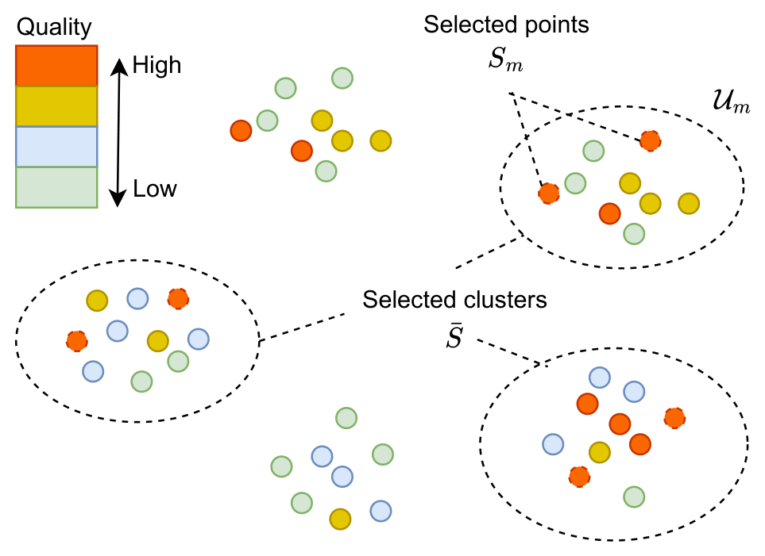
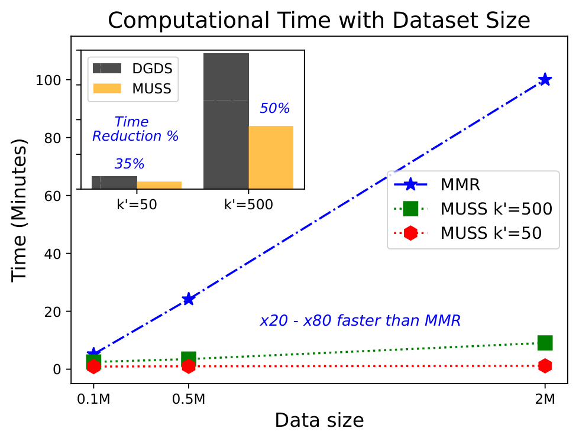

<div align="center">

# MUSS: Multilevel Subset Selection for Relevance and Diversity

**Jointly select items that are both _high quality_ and _high diversity_ — at the scale of millions.**

[](https://arxiv.org/pdf/2503.11126)
[](https://www.auai.org/)
[](LICENSE)

[Vu Nguyen](https://ntienvu.github.io) · Andrey Kan — **Amazon**

</div>

---

## Overview

Selecting a small subset that is simultaneously **relevant** and **diverse** is an NP-hard
problem at the heart of recommender systems and retrieval-augmented generation (RAG).
Greedy methods such as Maximum Marginal Relevance (MMR) do not scale, and partitioning
approaches like DGDS leave quality on the table.

**MUSS** uses a *multilevel* (partition → select-clusters → select-within) strategy that:

- 📈 improves recommendation precision by **up to 4 points**,
- ⚡ runs **20–80× faster** than MMR,
- 🧠 boosts RAG question-answering accuracy, and
- 🧮 comes with a **constant-factor approximation guarantee** (and a 2× tighter bound for DGDS).

<div align="center">

<br>
<em>Figure 2 (paper): MUSS clusters the corpus, then performs <strong>multilevel selection</strong> —
first choosing a diverse, high-quality set of clusters <code>S&#772;</code>, then selecting items <code>S<sub>m</sub></code>
within each chosen cluster <code>U<sub>m</sub></code>.</em>
</div>

<div align="center">

<br>
<em>Figure 1 (paper): MUSS scales to millions of items while MMR's runtime grows linearly.</em>
</div>

It supports two applications out of the box:

| Application | What MUSS picks |
|---|---|
| **Retrieval-Augmented Generation (RAG)** | Diverse, relevant context passages for an LLM to read |
| **Candidate Retrieval** | A diverse, high-quality subset from a large corpus (e.g. a product catalog) |

## How It Works

MUSS runs in three stages (`src/methods/muss.py`):

1. **Partition** — split the corpus into `n_partitions` groups (FAISS k-means or random).
2. **Select clusters** — pick `m` partitions using MMR on cluster centroids + median quality.
3. **Select within + final pass** — run MMR in parallel inside each selected partition,
   union with the top-`k` highest-quality items, then a final MMR pass over the union.

<details>
<summary><strong>Parameter reference</strong></summary>

| Parameter | Description |
|---|---|
| `k` | Number of items to select |
| `m` | Number of partitions selected in stage 2 |
| `n_partitions` | Total partitions created in stage 1 (must be > `m`) |
| `lamb` | Item-level quality/diversity trade-off (`0` = pure diversity, `1` = pure quality) |
| `lamb_c` | Partition-level quality/diversity trade-off |
| `k_within` | Items selected per partition in stage 3 (defaults to `k`) |
| `diversity_type` | `"sum"` (average pairwise) or `"min"` (nearest-neighbour) |

</details>

## Installation

```bash
pip install -r requirements.txt
```

> The RAG experiments additionally require an AWS account with access to **Claude Haiku via Bedrock**.

## Quick Start

The fastest way to see MUSS in action is the example notebook
[`muss_example.ipynb`](muss_example.ipynb). It generates synthetic data (N = 100k, d = 50),
runs MUSS to pick `k = 50` items, and compares quality and diversity against random selection.

Minimal Python usage:

```python
import numpy as np
from muss.src.methods.muss import muss

x = np.random.rand(100_000, 50)   # item embeddings
q = np.random.rand(100_000)       # quality scores

selected_idx, diagnostics = muss(x, q, k=50, m=100, n_partitions=200)
```

## Experiments

> [!IMPORTANT]
> All experiment scripts use package-style imports (`from muss.src.*`) and must be run
> **from the parent directory of `muss/`** as modules.

### RAG

The RAG runner reads a JSON config, embeds the corpus with HuggingFace, calls the chosen
retrieval method, queries Claude Haiku via Bedrock, and evaluates accuracy.

```bash
# from the parent of muss/:
python muss/src/generate_settings_rag.py                                # writes example configs to muss/outputs/
python -m muss.run_experiment_rag -i muss/outputs/ours-000.json -d 1000 -n 50
```

| Flag | Meaning |
|---|---|
| `-i / --input` | config file (**required**) |
| `-d / --data_size` | cap corpus size (optional) |
| `-n / --num_questions` | cap test-question count (optional) |

Results are written to `muss/outputs/results~*.csv` and `muss/outputs/*~answers.json`.
LLM responses are cached in `muss/outputs/_cache.json` to avoid redundant API calls.

**Available `method_key` values:**

| `method_key` | Description |
|---|---|
| `muss` | Full MUSS algorithm (requires `pre_proc_params`) |
| `random` | Random retrieval baseline |
| `dpp` | k-DPP baseline |

For `muss`, `pre_proc_params` takes `n_clusters` and `algorithm` — one of `packing_k_means`,
`packing_random`, `packing_balanced`, `packing_balanced_fast`. MMR is recovered by setting
`m=1`; DGDS by setting `algorithm=packing_random` and `add_max_q_to_union=False`.

### Candidate Retrieval

```bash
# from the parent of muss/:
python -m muss.run_experiment_candidate_retrieval           # MUSS, DGDS, MMR, Clustering, DPP, Random
python -m muss.run_experiment_candidate_retrieval_ablation  # MUSS ablation variants
```

Results are written to `temp/{dataset}.csv` (relative to the working directory you launched from).

The input DataFrame must have columns: `emb` (embedding vectors), `quality_score`, `label`,
`subcategory_code`, `ctr`. Optional categorical columns `cat_a`, `cat_b`, `cat_c` are used for
per-feature entropy reporting if present.

## Datasets

| Dataset | Path | Used in |
|---|---|---|
| StackExchange QA | `data/StackExchange/ExamData/llamav2_2023091223/exam.json` | RAG |
| DevOps QA | `data/DevOps/ExamData/html_llamav2_2023091421/exam.json` | RAG |

For candidate retrieval, supply your own parquet file with the columns listed above.
The [`muss_example.ipynb`](muss_example.ipynb) notebook demonstrates the algorithm on
synthetic data and is a good starting point.

## Baselines

| Method | Where | Notes |
|---|---|---|
| Random | `baselines.run_random_selection` | Uniform sampling |
| MMR | `baselines.run_experiment_MMR` | Greedy MMR over the full corpus |
| Clustering | `baselines.run_experiment_clustering` | FAISS k-means, top-quality per cluster |
| k-DPP | `baselines.run_experiment_DPP` | Exact k-DPP via `dppy` |
| DGDS | `baselines.run_DGDS` | Random partitioning + within-partition MMR (no cluster selection) |
| MUSS (full) | `helpers.run_MUSS` | Stage 1+2+3 with FAISS clustering |
| MUSS (rand. clusters) | `ablation_muss.run_MUSS_random_cluster_selection` | Stage 2 replaced by random selection |
| MUSS (rand. partition) | `ablation_muss.run_MUSS_rand_partition` | Stage 1 replaced by random partitioning |

## Repository Layout

```
muss/
├── data/                                       # datasets (parquet + JSON)
├── assets/                                     # figures used in this README
├── requirements.txt
├── muss_example.ipynb                          # quick-start notebook
├── run_experiment_rag.py                       # RAG experiment runner
├── run_experiment_candidate_retrieval.py
├── run_experiment_candidate_retrieval_ablation.py
├── src/
│   ├── methods/
│   │   ├── muss.py                             # core MUSS algorithm
│   │   ├── dpp.py, random.py                   # baselines
│   │   └── objectives.py                       # global quality+diversity objective (RAG only)
│   ├── candidate_retrieval/
│   │   ├── helpers.py                          # run_MUSS, evaluation, save_result
│   │   ├── baselines.py                        # MMR, clustering, DPP, random, DGDS
│   │   └── ablation_muss.py                    # MUSS ablation variants
│   ├── data_utils/
│   │   ├── read_data.py                        # StackExchange / DevOps loaders
│   │   └── embeddings.py                       # cached embedding + FAISS index
│   ├── llm/bedrock_language_model.py           # AWS Bedrock wrapper
│   └── generate_settings_rag.py               # build RAG configs
└── readme.md
```

## Citation

If you use MUSS in your research, please cite:

```bibtex
@inproceedings{nguyen2026muss,
  title     = {MUSS: Multilevel Subset Selection for Relevance and Diversity},
  author    = {Nguyen, Vu and Kan, Andrey},
  booktitle = {Uncertainty in Artificial Intelligence (UAI)},
  year      = {2026},
  url       = {https://arxiv.org/pdf/2503.11126}
}
```

## Contact

Questions? Reach out at [vu@ieee.org](mailto:vu@ieee.org).
